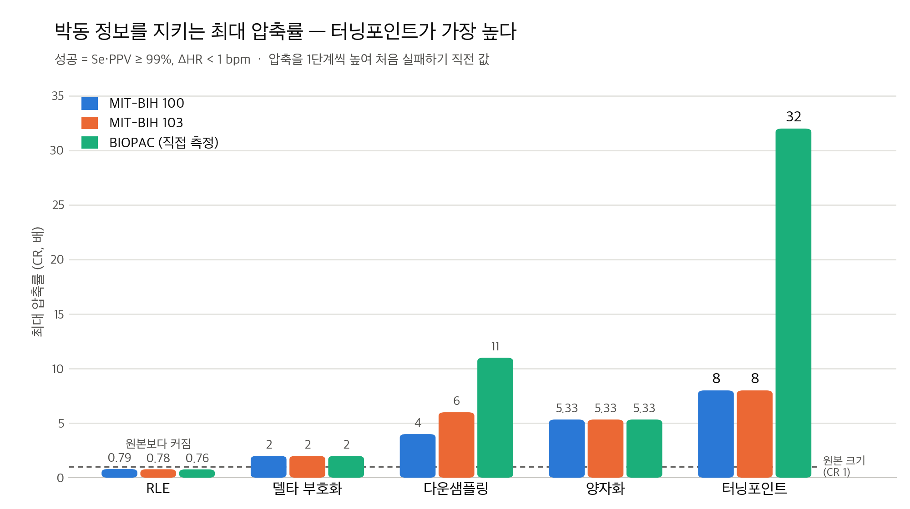
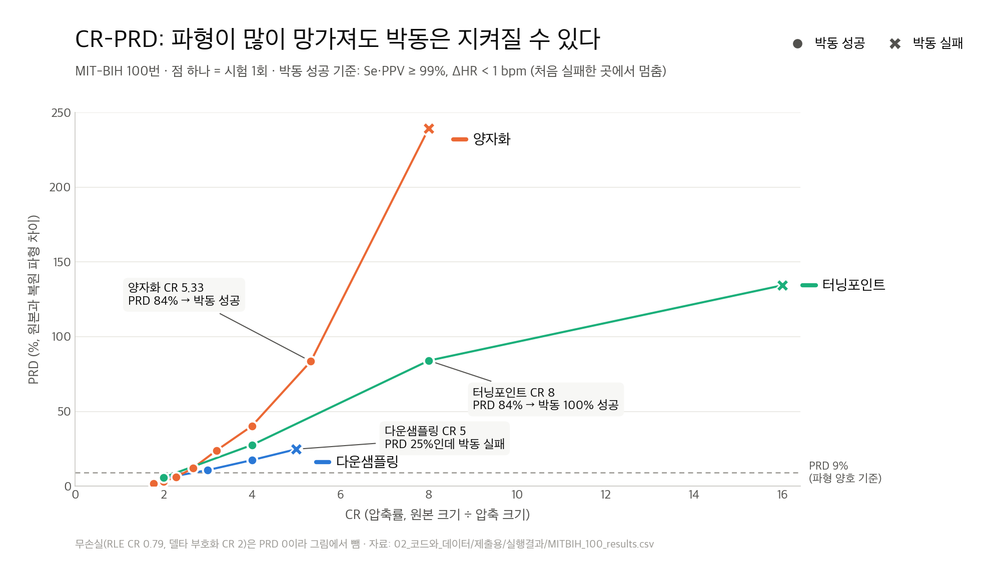

# ECG 압축 — 심장 박동 정보를 잃지 않고 몇 배까지 줄일 수 있을까?

ECG 압축 기법 5가지를 **C로 직접 구현**하고, 압축했다가 복원한 신호에서도 **심장 박동을 똑같이 찾을 수 있는 최대 압축률**을 찾는 프로그램입니다.

가톨릭대 AI의공학과 2026-2 「Computers & Programming 2」 중간 팀 프로젝트(2조)입니다.

## 왜 박동을 기준으로 했나
연구실에서 ECG를 측정하면 사흘 동안 파일 25개, 약 200MB가 쌓였습니다. 3분짜리 파일 하나가 21MB이고, 하루 동안 한 채널만 기록해도 약 1.7GB가 됩니다. 데이터를 줄여야 하는데, 원본 파형을 얼마나 닮았는지(PRD)보다 **진단에 실제로 쓰는 정보(박동 위치와 심박수)가 남는지**가 더 중요하다고 봤습니다.

**성공 기준** (원본에서 찾은 박동과 복원본에서 찾은 박동 비교)
- Se(민감도) ≥ 99%: 원본 박동을 복원본에서도 찾았나
- PPV(양성예측도) ≥ 99%: 없는 박동을 만들지 않았나
- ΔHR < 1 bpm: 심박수 차이

압축 단계를 한 칸씩 올리다가 **처음 실패한 단계 바로 앞**을 최대 압축으로 봅니다. PRD는 판정에 쓰지 않고 참고로만 기록합니다.

## 결과



| 방법 | 종류 | MIT-BIH 100 | MIT-BIH 103 | MIT-BIH 119 | BIOPAC (직접 측정) |
|---|---|---|---|---|---|
| RLE | 무손실 | CR 0.79 (오히려 커짐) | 0.78 | 0.76 | 0.76 |
| 델타 부호화 (8비트) | 무손실 | CR 2 | 2 | 2 | 2 |
| 다운샘플링 | 손실 | CR 4 (90 Hz) · PRD 17% | 6 (60 Hz) | 5 (72 Hz) | 11 (182 Hz) |
| 양자화 | 손실 | CR 5.33 · PRD 84% | 5.33 | 3.20 | 5.33 |
| **터닝포인트** | 손실 | **CR 8** · PRD 84% | **8** | **8** | **32** |

**알게 된 것**
1. **박동을 지키는 데는 터닝포인트가 가장 강합니다.** 같은 CR 8에서 다운샘플링은 박동을 놓치기 시작했지만(Se 78~89%) 터닝포인트는 100%였습니다. 기울기 방향이 바뀌는 점(꼭짓점)을 남기므로 R파 꼭대기가 살아남기 때문입니다.
2. **파형이 망가져도 박동은 지켜질 수 있습니다.** 양자화는 PRD 84%인데 박동 일치율은 99.96%였습니다. PRD와 박동 보존은 따로 움직입니다.
3. **"무엇을 남길지"에 따라 최대 압축이 달라집니다.** 박동만 필요하면 CR 8, 파형까지 보존해야 하면(PRD < 9%) CR 2~3입니다.
4. 다운샘플링의 한계는 배율보다 **남은 샘플링 속도(Hz)** 로 보는 게 맞습니다. 360 Hz 기록은 60~90 Hz 아래로 내려가면 실패했습니다.
5. ECG는 같은 값이 연속되는 일이 드물어서 RLE를 쓰면 오히려 커집니다.



## 구현한 기법

| 기법 | 원리 | 복원 |
|---|---|---|
| RLE | 같은 값이 이어지면 (값, 개수)로 저장 | 무손실 |
| 델타 부호화 | 앞 값과의 차이를 1바이트로 저장 (`int`로 계산·범위 검사 후 `char`에 저장) | 무손실 |
| 다운샘플링 1/n | n개마다 1개만 남김, 복원은 선형 보간 | 손실 |
| 양자화 | 최솟값을 뺀 뒤 하위 s비트를 버림 (비트 시프트) | 손실 |
| 터닝포인트 L단계 | 2개 중 기울기 방향이 바뀌는 점을 남김, L번 반복해 CR 2^L | 손실 |

**R파 검출**: 2초 구간마다 기준값을 정하고, 기준값을 넘는 꼭대기를 찾되 0.2초 안에는 하나만 인정합니다. 의사 판독과 비교한 정확도는 100·103번 100%, 119번 99.9%입니다.

## 실행

```bash
clang -Wall -O2 -o ecg ecg_compression.c -lm    # 또는 gcc
./ecg
```

메뉴: `1` MIT-BIH 읽기 → 기록 번호(100, 103, 119, 203, 208) → `3` 압축 실험 → `0` 종료

```
예) 1 → 100 → 3 → 0
```

결과표가 화면에 나오고 `results_MITBIH_100.csv`로 저장됩니다. 레포 최상위 폴더에서 실행해야 `data/`를 찾습니다. Windows Visual Studio에서도 실행을 확인했습니다(소스는 UTF-8 BOM).

## 폴더

```
ecg_compression.c   전체 코드 (한 파일, 약 930줄)
data/               MIT-BIH 5개 기록: 신호 CSV + 의사 판독 주석
results/            7개 데이터의 실행 출력(*_출력.txt)과 결과표(*_results.csv)
figures/            발표용 그래프
```

`data/`에 BIOPAC 측정 파일(`ecg_t3_03.txt`)은 없습니다. 연구실에서 측정한 데이터라 공개하지 않았고, 메뉴 2번은 이 파일이 있어야 동작합니다. BIOPAC 결과는 `results/`에 남겨 두었습니다.

## 한계
- MIT-BIH 203·208번은 부정맥이 많아 R파 검출 정확도가 99% 미만(203: 73.1%, 208: 97.7%)이라 압축 결과 비교에서 제외했습니다. 비교 기준인 원본 박동부터 틀린 상태이기 때문입니다. 개선 방향은 Pan-Tompkins 같은 검출기입니다.
- BIOPAC 데이터는 박동 수가 적어서(146개, 72개) 최대 압축 값이 흔들릴 수 있습니다.
- MIT-BIH는 모두 부정맥 환자의 기록입니다. 100·103번은 "정상인 데이터"가 아니라 "정상 리듬이 대부분인 기록"입니다.

## 팀
| 역할 | 맡은 일 |
|---|---|
| 조장 (레포 작성자) | 기획, PM, 데이터 수집, 코드 검증·통합, 파일 입출력·R파 검출·메뉴·터닝포인트 |
| 팀원 A | 다운샘플링, 양자화 |
| 팀원 B | RLE, 델타 부호화 |
| 팀원 C | 발표, 손실 압축 시각화 |
| 팀원 D | 발표, 무손실 압축 시각화 |

과제 규정에 따라 생성형 AI(Claude)를 코드 작성과 디버깅에 사용했고, 사용 과정은 발표에서 공개했습니다.

## 데이터 출처
- MIT-BIH Arrhythmia Database — Moody GB, Mark RG. *The impact of the MIT-BIH Arrhythmia Database.* IEEE Eng Med Biol 2001. ([PhysioNet](https://physionet.org/content/mitdb/), ODC-By 1.0)
- CSV 변환본: Kaggle "MIT-BIH Database" (Victor Mondejar, CC0)
